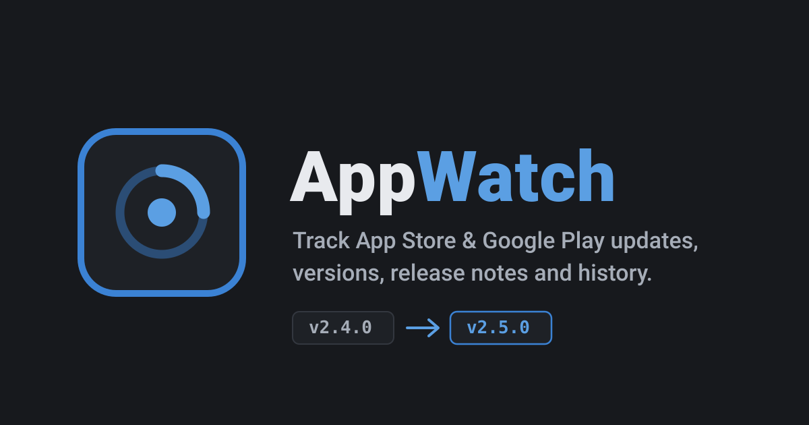
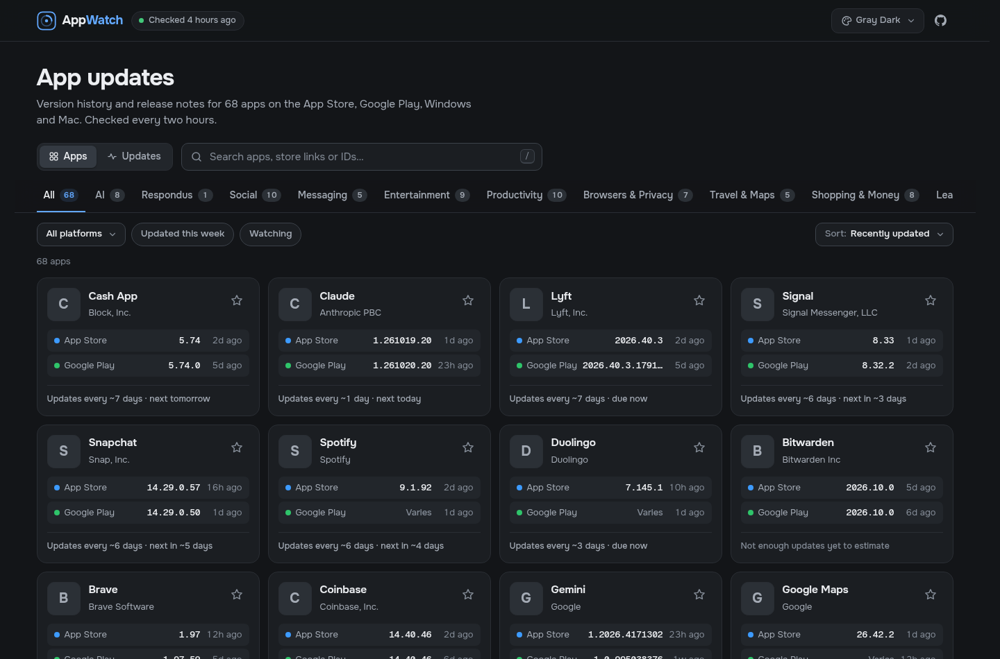
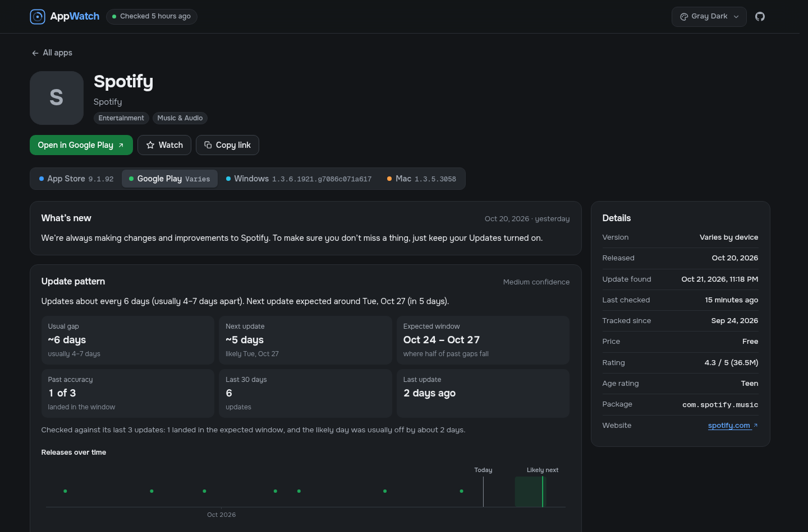
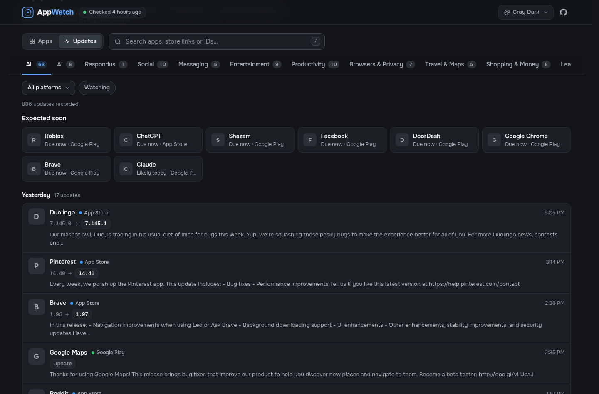
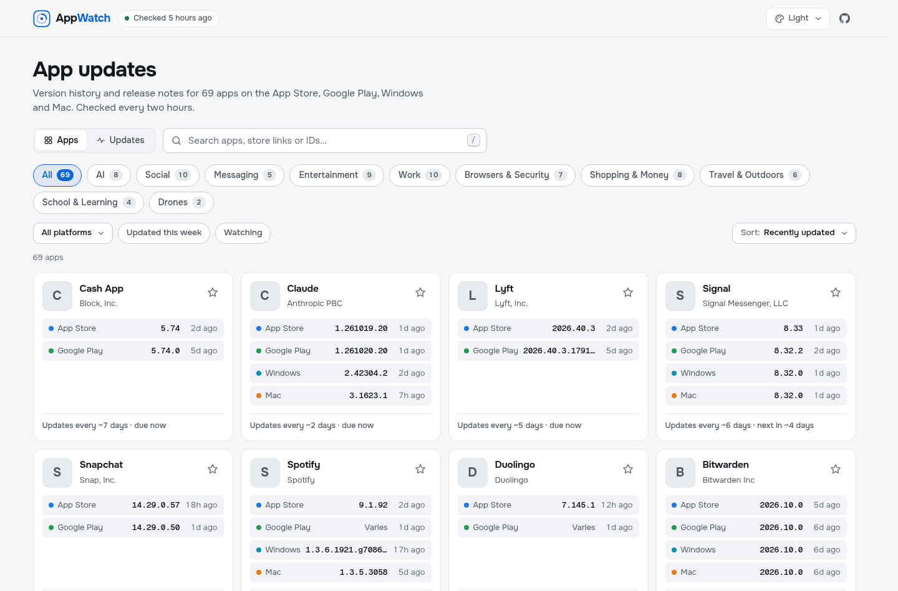
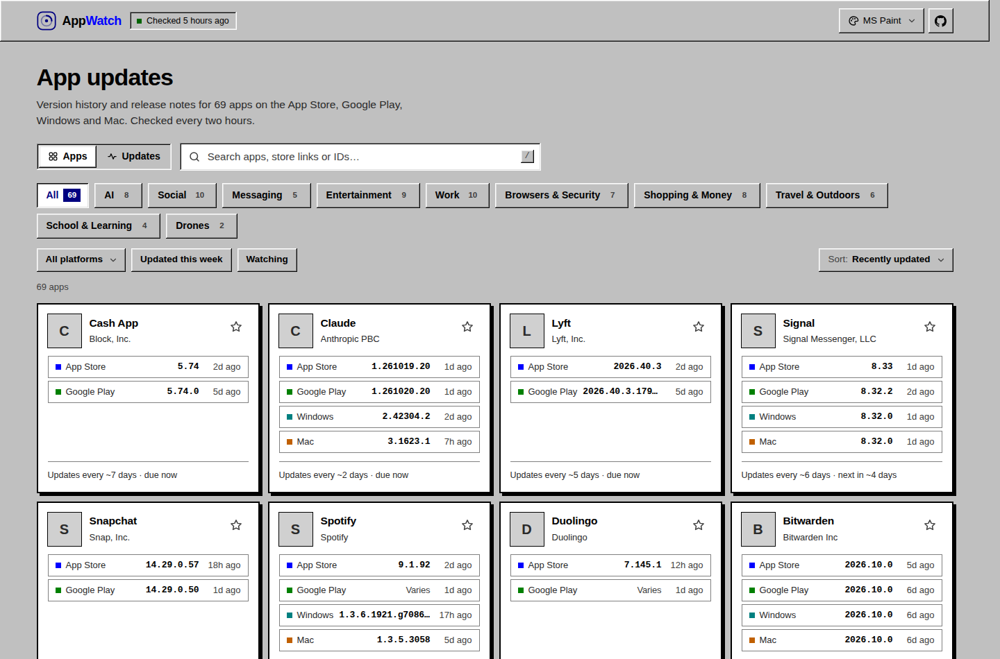

<p align="center">
  
</p>

<h1 align="center">AppWatch</h1>

<p align="center">
  A modern dashboard that tracks <strong>App Store</strong> and <strong>Google Play</strong> app updates —
  versions, release notes, release dates and full version history.
</p>

<p align="center">
  <a href="https://dawsoncodes.github.io/AppWatch/"><strong>➜ Live site</strong></a>
  ·
  <a href="https://github.com/DawsonCodes/AppWatch/issues/new/choose">Report an issue</a>
  ·
  <a href="#adding-and-removing-tracked-apps">Add an app</a>
</p>

<p align="center">
  
</p>

---

## Preview

|                       Gray Dark (default)                       |                     App page                      |
| :-------------------------------------------------------------: | :-----------------------------------------------: |
|  |  |

<details>
<summary>Updates timeline, Light and MS Paint themes</summary>







</details>

> Screenshots use real tracked data but were captured offline, so app icons
> show their letter fallback (the live site loads the real icons) and the
> newest store apps, which resolve on their first online check, aren't shown.

---

## What it does

AppWatch tracks 75 apps out of the box — 192 listings across the App Store,
Google Play, Windows and Mac — checks every one of them **every two hours**,
and records what changed. Apps are grouped into categories, shown as chips
above the list: **AI** (ChatGPT, Gemini, Grok, Microsoft Copilot, Perplexity,
DeepSeek, Character.AI and more), **Social**, **Messaging**,
**Entertainment**, **Work**, **Browsers & Security**, **Shopping & Money**,
**Travel & Outdoors**, **School & Learning** (including LockDown Browser) and
**Drones** (DJI Fly, DJI GO 4, Litchi, DroneDeploy, FreeFlight 7,
UAV Forecast, Aloft Air Control and QGroundControl).

Every app that has a Windows or Mac version AppWatch can track reliably has
it tracked too — 22 Windows and 27 Mac listings, from Chrome, Firefox, Edge
and Brave to Spotify, Discord, Slack, Zoom, Notion and the AI desktop apps.

Each app is one card covering every platform it's tracked on, with the **App
Store in blue**, **Google Play in green**, **Windows in cyan** and **Mac in
orange** everywhere (platform names are always written out too, so color is
never the only cue). For every tracked app it shows:

- Name, icon, developer and category
- Platform (App Store / Google Play / Windows / Mac) with a direct link
- Current version and the previous version it replaced
- Release date and how long ago that was
- The full "What's New" release notes, rendered safely as plain text
- Complete stored version history with detection timestamps
- Price, user rating, content rating, minimum OS requirement, download size
  and developer website, where the store exposes them
- Whether an update was detected recently, and when the last check ran
- Per-app check failures, without breaking the rest of the dashboard

Visitors can search (by name, developer, store URL, Apple ID or package name),
switch collections, filter by store, recency or watchlist, sort, discover apps
beyond the built-in list, and keep a personal **watchlist** — stored only in
their own browser.

### The Updates timeline

The **Updates** view lists every release AppWatch has recorded, newest first
and grouped by day (Today, Yesterday, weekday, date). Each entry shows the app,
the store, the version change (`1.4 → 1.5`) and the start of its release
notes; tap one to open that app's page. It honors the same collection, store,
watchlist and search filters as the grid, and it only contains releases the
checker actually saw — the version each listing had when tracking began
(marked "first recorded") plus every change since.

### App pages

Tapping an app opens its own page (a normal link, `#app=<platform>:<id>`, so
Back, new tabs and shared links all work). It shows the current version's
release notes, how often the app updates, every recorded version, and a
details column (version, dates, price, rating, size, store ID and more). Apps
on several platforms get a tab per platform. Going back returns to the list
exactly where you left it.

### How often apps update

Every app's history doubles as a record of how often it ships. AppWatch looks
at the gaps between each listing's recent releases (up to the last 24) and
estimates when the next one will land:

- Recent gaps count more than old ones (a gap counts half as much as the one
  eight releases newer), so a change of rhythm is picked up.
- Gaps are compared on a log scale, so one long pause doesn't skew things.
- The expected window is the middle half of those gaps after the last release,
  and the likely day inside it leans toward the weekdays the app usually
  ships on.

This method was chosen by backtesting against the release histories AppWatch
has recorded (132 listings): for each past release, "what would we have
predicted right before it?", compared with when it really came. Against the
previous plain median it cut the typical miss from about 2.0 to 1.8 days and
raised the share of releases landing inside the expected window from 41% to
50%. It then shows:

- **On every card** — "Updates every ~6 days · next in ~3 days", "due now" or
  "overdue"; apps with fewer than four recorded releases say there aren't
  enough updates yet to estimate.
- **On the app page** — an Update pattern section with the usual gap and
  range, the most likely date for the next update, the expected window,
  **past accuracy for that app** (the same backtest, run on its own history:
  "5 of 8 landed in the window, usually off by about 3 days"), updates in the
  last 30 days, a weekday pattern when there is a clear one, and a confidence
  level based on that past accuracy, plus two charts (releases over time, with today
  and the likely window ahead, and the days between releases with the usual
  gap marked) and every release date as a table. Charts are keyboard-navigable
  (arrow keys) and work in all three themes.
- **Sort → Next update**, an **Expected soon** row at the top of the Updates
  view, and an "Expected in the next 3 days" count under Stats.

These are estimates from past behavior — app makers don't publish schedules —
and the accuracy line says how well they've worked for each app.

### Desktop releases (Windows and Mac)

Desktop software isn't sold through a store AppWatch can query, so each
desktop listing names where its versions come from:

- **Windows: winget**, Microsoft's Windows Package Manager. Its public
  manifest repository (`microsoft/winget-pkgs`) has a folder per version of
  each package, usually with the release date and often the release notes and
  a link to the official notes. Each version is added by a "New version: …"
  commit, so the folder's history doubles as a dated version record; the
  checker uses the manifests' release dates where present and the commit dates
  otherwise (never letting an older version be dated after a newer one).
- **Mac: Homebrew**, the standard macOS package manager. Each cask follows the
  app's official download; Homebrew's JSON API gives the current version, and
  the cask's history in `Homebrew/homebrew-cask` shows when each version
  arrived (Homebrew's bot opens a "<cask> <version>" commit within hours of a
  release). Homebrew carries no release notes.
- **Vendor release feeds** for software in neither, like LockDown Browser
  (below).

Both catalogs are read-only and keyless; in GitHub Actions the run's own
token raises the GitHub API limit. Apps whose desktop version is only in the
Microsoft Store or Mac App Store (for example WhatsApp, ChatGPT and Netflix on
Windows) aren't tracked there, because those stores publish no version
numbers AppWatch can read; nor are packages whose winget entry has gone stale
(Dropbox, Teams and Outlook on Windows), since stale data would mislead.

LockDown Browser is read from Respondus's own announcements: Respondus posts every Windows and Mac release
("LockDown Browser for Windows, version 2.1.6.02") with notes on its help
center, and the checker reads those posts through the help center's public
API on every run.

Posts that were moved into Respondus's current help center all carry the
move date (December 2021) as their creation date, so the checker takes each
post's real date from its "Posted by Respondus Support on …" line instead.

Because that is the vendor's complete public record, a desktop listing's
version history goes back as far as the announcements do — every Windows and
Mac version with its release date, notes and a link to the original
announcement — not just from the day tracking started. Entries learned from
that archive are marked as such ("Earliest on record" on the oldest one).

LockDown Browser for iPad is tracked through the App Store like any other app.
The Chromebook extension isn't tracked: schools install it through their own
Respondus links, and there's no public version record to read. DJI Fly is
tracked on the App Store; on Android DJI distributes it as a download from its
own site with no public version feed, so there's nothing reliable to check.

### Can AppWatch keep old versions to download?

The public dashboard keeps the complete **version record**: every version, its
release date, its notes and (for desktop releases) the official announcement, stored in
`public/data/history.json` and shown on each app's page and in the Updates
timeline. Get the installer itself from your school's link or the official
page.

An optional [private Windows archive](docs/lockdown-archive.md) can preserve
future Respondus installers in the owner's private Dawson Bot repository.
It runs as part of the existing checker, saves each detected version once,
and retains prior installers. No installer, institution download link, or
private archive configuration is published by AppWatch. The archive requires a
separate repository-scoped secret and an initial successful save; announcement
history alone cannot recover installers that are no longer available.

## Themes

Three complete themes, selectable from the header:

- **Gray Dark** — the default dark theme: neutral charcoal, restrained blue
  accent, no glow.
- **Light** — clean off-white surfaces with the same blue accent family.
- **MS Paint** — a playful tribute to classic desktop paint software: raised
  and inset bevels, silver window chrome, white canvases with hard shadows and
  a color-palette strip in the footer. It uses no Microsoft trademarks,
  logos or proprietary assets, and it stays fully readable and accessible.

Your choice is saved in the browser (`localStorage`). On a first visit the
operating-system light/dark preference picks Gray Dark or Light; MS Paint is
only ever active because you chose it.

### Motion

Motion is kept small on purpose, so nothing can get stuck, overlap or hide
content:

- Pages and menus fade in quickly; hovering changes colors and borders only.
- App icons show the app's first letter straight away and fade in once
  loaded. Every icon is requested at one size and remembered for the visit, so
  an icon that has loaded once shows instantly everywhere else, and one that
  can't load keeps its letter instead of popping in later.
- The theme switch reveals the new theme in a circle from the theme button (in
  pixel steps for MS Paint), and watching an app gives the star a small pop.
- Everything becomes an instant change under `prefers-reduced-motion`.

### Translating release notes

Release notes that aren't in English get a **Translate** button. Browsers with built-in on-device translation (recent Chrome) translate
right there — nothing is sent anywhere — with a "Show original" toggle.
Everywhere else the button opens Google Translate in a new tab with the notes
filled in. AppWatch itself never calls a translation service.

## Store-wide discovery & your local watchlist

The dashboard is not limited to the repository-configured apps — but honesty
matters about how far that goes:

- **Repository-tracked apps** (from `apps.config.json`) are checked every two
  hours by GitHub Actions for everyone, with stored version history.
- **App Store discovery** works live in your browser: paste an App Store URL
  or numeric ID, or press Enter on a name search, and AppWatch queries Apple's
  public keyless lookup/search API — one request per action, no key, no proxy.
  Some networks/regions don't send the CORS headers this needs; when that
  happens AppWatch says so and offers external store-search links instead.
- **Google Play has no browser-readable metadata API.** Play URLs and package
  names are recognized and can be added with a store link, but their metadata
  cannot be fetched client-side, and AppWatch does not fake it or route it
  through some third-party proxy.
- Apps you add this way become **local watches**: they live only in your
  browser's localStorage, appear under a **Your watches** tab and are labeled
  "Saved in this browser", are _not_ checked by the scheduled pipeline, and
  never sync anywhere. The app's page offers a copyable `apps.config.json`
  entry and a link to the tracking-request issue form if you want an app
  promoted to real repository tracking (nothing is ever submitted
  automatically).

## Data freshness (is it real time?)

No — and AppWatch won't pretend otherwise. Neither store pushes update events
to third parties, and a GitHub Pages site has no server to poll continuously,
so "instant" universal detection is not honestly possible with this
architecture. What AppWatch does instead:

- The checker runs every two hours (see the schedule below) and redeploys the
  site after every run, so the published "last checked" time is always real.
- While the page is open, it revalidates the site's **own** tiny
  `status.json` every 5 minutes and whenever the tab regains focus (visible
  tabs only). When a newer run has been deployed, the new data is applied in
  place automatically — no page reload; filters, scroll position and the open
  page are kept.
- Every data request revalidates with the server (`cache: no-cache`), so
  GitHub Pages' 10-minute HTTP cache can never hide a fresh deploy.
- Your browser never queries the App Store or Google Play for tracked data;
  only the explicit discovery search above contacts Apple's public API.

## How it works

```
apps.config.json          (human-edited: which apps to track)
        │
        ▼
GitHub Actions (every 2 h)   ─►  scripts/check-updates.ts
        │                        ├─ Apple provider  → iTunes Lookup API (batched)
        │                        └─ Google provider → google-play-scraper
        ▼
public/data/*.json        (generated, version-controlled)
  apps.json    normalized app records
  history.json version history per app
  status.json  checker run summary
        │
        ▼
GitHub Pages              (static Vite + Preact frontend reads the JSON)
```

There is **no server, no database, no accounts and no API keys**. The data
lives in git, the checker runs on a schedule in GitHub Actions, and the site is
plain static hosting. A checker run only commits (and redeploys) when something
meaningful changed — timestamp-only churn is ignored.

### Update detection & version history

When the checker sees a version different from the stored one it:

1. moves the old version to `previousVersion`,
2. records the new version, its release date and the release notes available at
   detection time,
3. prepends a history entry (duplicates by version are rejected),
4. stamps `lastUpdatedAt` so the UI can badge the app as recently updated.

Some Google Play listings publish no single version ("Varies with device").
For those, a **newer store release date** counts as an update: the history
entry is recorded with `version: null` and keyed by its release date, so these
apps get update badges, timeline entries and release notes too. Only a forward
move of the date counts, and nothing is invented when the store gives no
date.

History is never fabricated: each app's history starts from the first
successful snapshot and grows as real updates are detected. Failed checks keep
the last good data and surface a per-app error instead.

## Tech stack

| Layer       | Choice                                                                                                      |
| ----------- | ----------------------------------------------------------------------------------------------------------- |
| Frontend    | [Vite](https://vite.dev) + [Preact](https://preactjs.com) + TypeScript, hand-written CSS                    |
| Type        | Onest (UI) and Geist Mono (versions), self-hosted via Fontsource — no font CDN                              |
| Checker     | Node.js 22 + [tsx](https://tsx.is), no framework                                                            |
| Apple data  | iTunes Lookup API (public, keyless)                                                                         |
| Google data | [google-play-scraper](https://github.com/facundoolano/google-play-scraper), isolated in one provider module |
| Tests       | [Vitest](https://vitest.dev) with fully mocked store responses                                              |
| CI/CD       | GitHub Actions → GitHub Pages                                                                               |

## Local development

Requires Node.js ≥ 20 (see `.nvmrc`).

```bash
git clone https://github.com/DawsonCodes/AppWatch.git
cd AppWatch
npm ci
npm run dev          # dev server at http://localhost:5173/AppWatch/
```

### Commands

| Command                 | Purpose                                               |
| ----------------------- | ----------------------------------------------------- |
| `npm run dev`           | Dev server with hot reload                            |
| `npm run build`         | Production build into `dist/`                         |
| `npm run preview`       | Serve the production build locally                    |
| `npm test`              | Run the test suite (no network access needed)         |
| `npm run lint`          | ESLint                                                |
| `npm run typecheck`     | TypeScript                                            |
| `npm run format`        | Prettier write / `format:check` to verify             |
| `npm run check:updates` | Run the real store checker locally (network required) |
| `npm run validate:data` | Validate `public/data/*.json`                         |
| `npm run verify`        | The full CI gauntlet in one command                   |

## Adding and removing tracked apps

Edit **`apps.config.json`**. Apps live in **collections**, and each
collection becomes a tab on the site. An app is a name plus its store links —
one or both; the IDs are extracted from the URLs automatically:

```jsonc
{
  "country": "us", // default App Store storefront / Play country
  "language": "en", // language for Google Play metadata
  "collections": [
    {
      "id": "ai", // short lowercase id
      "label": "AI", // tab label
      "apps": [
        {
          "name": "ChatGPT",
          "appStore": "https://apps.apple.com/us/app/chatgpt/id6448311069",
          "googlePlay": "https://play.google.com/store/apps/details?id=com.openai.chatgpt",
        },
        // Bare IDs work too: an Apple numeric ID or an Android package name.
        { "name": "Wikipedia", "appStore": "324715238", "googlePlay": "org.wikipedia" },
      ],
    },
  ],
}
```

- Collections appear in the order written; add, rename or reorder them freely.
- A listing can belong to only one app; duplicates are reported and ignored.
- Desktop listings name their source instead of a store link:
  `"windows": "winget:Spotify.Spotify"` (a winget package identifier, as in
  the `microsoft/winget-pkgs` repository), `"mac": "homebrew:spotify"` (a
  Homebrew cask token, or a `https://formulae.brew.sh/cask/…` link), or a
  release feed id such as `"respondus-lockdown-browser"` (feeds are listed in
  `src/shared/feeds.ts`). Check that the package is kept current before adding
  it.
- The older flat format — a top-level `"apps"` array of store URLs or
  `{ "platform", "id" }` objects — still works; those apps land in an "Other"
  tab.

Removing an entry removes the app (and its stored history) from the dashboard
on the next check. After changing the config you can wait for the next
scheduled run or trigger **Actions → Check app updates → Run workflow**.
Newly added apps appear once that run has resolved them.

## Data files

The checker writes these files into `public/data/` (do not edit by hand):

- **`apps.json`** — one normalized record per app (`id`, `platform`, `storeId`,
  `name`, `developer`, `iconUrl`, `storeUrl`, `currentVersion`,
  `previousVersion`, `releaseDate`, `releaseNotes`, `category`, `bundleId`,
  `firstTrackedAt`, `lastCheckedAt`, `lastUpdatedAt`, `checkStatus`,
  `checkError`, `updateDetected`, plus extended metadata where the store
  exposes it: `price`, `contentRating`, `requiresOs`, `sizeBytes`, `rating`,
  `ratingCount`, `developerWebsite`, and for desktop listings `releaseUrl`, the
  official release notes page or announcement). `platform` is `apple`,
  `google`, `windows` or `mac`; desktop listings use `winget:<id>`,
  `homebrew:<cask>` or a release feed id as `storeId`. Fields a store doesn't provide are
  `null`, never faked, and files generated before these fields existed remain
  valid — the extended fields are optional in the schema.
- **`history.json`** — version history per app id, newest first; one entry per
  version with release date, notes and the detection timestamp (plus `url`,
  the official announcement, for desktop releases). For listings that publish
  no version, entries have `version: null` and are unique by release date.
- **`status.json`** — last run time, success/failure counts, updates detected.
  Rewritten on every run and deployed straight to the site; it is only
  committed alongside real app changes, so the git history stays meaningful.

## Deployment (GitHub Pages)

The site deploys automatically; one-time repository setup:

1. **Settings → Pages → Build and deployment → Source: GitHub Actions.**
2. **Settings → Actions → General → Workflow permissions: Read and write
   permissions** (the checker commits data with the built-in `GITHUB_TOKEN`;
   no personal tokens or secrets are used).

Workflows:

- **`deploy.yml`** — builds, validates and deploys on every push to `main`
  (also manually via _Run workflow_). The Vite `base` is `/AppWatch/`, so the
  site works correctly at `https://dawsoncodes.github.io/AppWatch/`.
- **`check-updates.yml`** — runs every two hours and on demand; commits
  `chore(data): update tracked app metadata` only when app data actually
  changed, then deploys the site after every successful run (handing the
  freshly generated data, including `status.json`, to the deploy job as an
  artifact). Commits made with `GITHUB_TOKEN` cannot re-trigger workflows, so
  the checker → deploy chain is loop-safe by construction.

### Check schedule

The checker runs **every two hours** (`17 */2 * * *`, UTC) and on demand via
**Actions → Check app updates → Run workflow**.

GitHub runs scheduled workflows on a best-effort basis: runs routinely start
minutes to hours after their cron time, and the top of the hour is the most
congested (hence `:17`). The workflow therefore never depends on starting at
an exact clock time — whenever a run starts, it checks every tracked app.

A single run checks all ~100 apps in a few minutes and stays polite to the
stores: App Store apps are resolved with one batched lookup per 50 apps, and
Google Play pages are fetched one at a time at least 1.5 seconds apart
(tunable with `APPWATCH_DELAY_MS`).

> **Why not exactly 12:00 AM / 12:00 PM?** An earlier version gated runs to
> those Detroit hours. Because GitHub started the scheduled runs several hours
> late, every run failed the gate and was skipped, so the data silently stopped
> updating. The frequent, delay-tolerant schedule removes that failure mode —
> and checks midnight and noon along with every other two-hour slot.

## Known limitations

- **Google Play metadata is scraped.** Google offers no public metadata API,
  so the Play provider parses the public store pages via `google-play-scraper`.
  Google changes that page structure occasionally; when it breaks, affected
  apps show a "check failed" badge with their last good data until the provider
  (an isolated module: `scripts/lib/providers/googleplay.ts`) or the upstream
  package is updated. Some Play listings also report no concrete version
  ("Varies with device") — AppWatch stores `null` rather than a fake version.
- **Desktop versions follow their package catalogs.** winget and Homebrew are
  community-maintained with automated bots; new versions usually appear within
  hours (Homebrew) to a day or two (winget). A package whose maintainers stop
  updating it would go stale, so desktop sources are chosen per app, and the
  app page always says which catalog a version came from.
- **Desktop feeds follow the vendor's announcements.** LockDown Browser
  versions come from Respondus posts titled "LockDown Browser for Windows/Mac,
  version …". If Respondus changes how it titles or files those posts, the
  Windows/Mac listings show a "check failed" badge with their last good data
  until the provider (`scripts/lib/providers/respondus.ts`) is adjusted. A
  release Respondus later withdraws still appears, because its announcement
  stays published.
- **Release notes reflect detection time.** Stores overwrite notes in place;
  history entries keep the notes as they were when each version was first seen.
- **Freshness is bounded by the schedule.** A store update appears on the site
  within about two hours (plus any GitHub scheduling delay), not instantly —
  neither store offers a push feed a static site could subscribe to.
- **Push-triggered deploys use the last committed status.** A code change
  merged to `main` redeploys with the most recently _committed_ `status.json`,
  so "last checked" can read slightly older until the next scheduled run
  (at most two hours later).
- **Apple storefront matters.** Version metadata can differ per country; the
  configured storefront (default `us`) is what gets tracked.
- **In-browser App Store discovery depends on CORS.** Apple's public
  lookup/search endpoint does not send cross-origin headers on every
  network/region. When a browser can't reach it, discovery degrades to
  external store-search links — it never proxies or fabricates results.
- **Ratings drift constantly.** Stored `rating`/`ratingCount` values refresh
  whenever a run commits for other reasons; pure rating drift alone is not
  worth a data commit, so those two fields can lag slightly.

## Troubleshooting

| Symptom                                        | Likely cause / fix                                                                                                                         |
| ---------------------------------------------- | ------------------------------------------------------------------------------------------------------------------------------------------ |
| Newly added apps don't appear yet              | They show up after the next check — run **Actions → Check app updates** to populate them now.                                              |
| An app is listed under "Couldn't resolve"      | The configured ID or package doesn't resolve (typo, or the listing was removed from the US store). Fix or remove it in `apps.config.json`. |
| Site loads but shows "No app data yet"         | The checker hasn't run since setup — run **Actions → Check app updates** manually.                                                         |
| Checker fails with "Every check failed"        | Runner couldn't reach the stores (outage or rate limiting) — rerun later; nothing was overwritten.                                         |
| One app shows "Check failed"                   | Usually a temporary store error, a removed listing, or a Play page-format change. The card keeps the last good data.                       |
| Deploy succeeds but assets 404                 | The site must be served from `/AppWatch/` — don't change `base` in `vite.config.ts` unless the repo name changes.                          |
| `npm run check:updates` locally returns errors | Some networks/proxies block store endpoints; the GitHub Actions runner is the reference environment.                                       |

## Privacy

AppWatch collects nothing. No analytics, no cookies, no fingerprinting, no ads.
Your watchlist, local watches, theme choice and view preferences are kept in
your browser's localStorage and never leave your device. The site talks to its
own origin (data JSON), loads app icons from the stores' CDNs, and contacts
Apple's public search API only when you explicitly use the discovery search.

## Contributing

See [CONTRIBUTING.md](CONTRIBUTING.md). Bug reports, feature ideas and
app-tracking suggestions are all welcome — this project follows the
[Contributor Covenant](CODE_OF_CONDUCT.md).

## License

[MIT](LICENSE) — Copyright © 2026 DawsonCodes
